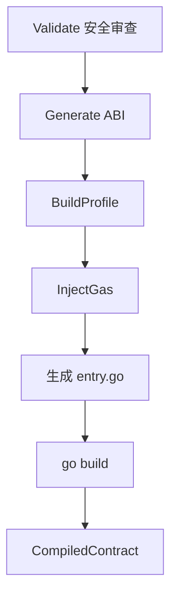

# 编译器模块详细设计

## 1. 概述

`ContractCompiler` 负责把合约源码变成可执行产物。当前默认构建器是 **`go build`**；TinyGo 为后置可选适配。

## 2. 流水线



## 3. 接口

```go
type ContractCompiler interface {
    Compile(context.Context, string) (*CompiledContract, error)
}
```

实现位于 `internal/compiler`，由 `plugins/compiler` 注入 SourcePolicy、ABIGenerator、GasInjector 和 GasProfileBuilder。安全审查接口仅有 Review，Validate/InjectGas 辅助方法不属于编译插件契约。调用方上下文贯穿构建，取消时清理临时目录，构建超时派生于该上下文。

源码策略可通过 PolicyGuarantor 声明保证，编译器检查保证而非固定策略 ID；产物写入策略 ID 和 Guarantees。确定性策略采用受控构建环境。

## 4. Gas 注入（MVP）

在 AST 中插入 `__vmConsumeGas(n)`：

- 每个函数入口
- `for` / `range` 循环体开头

入口基础 Gas 在 `entry.go` 中消耗（当前 10）。

## 5. 入口生成

- 合约源码不得包含 `main`
- 编译器生成独立 `entry.go`：解析 stdin JSON、按函数名分发、输出 JSON 结果与 Gas
- 参数和返回类型由统一 ABI schema 验证，支持标量及末尾 error 返回；不支持的签名在生成入口前拒绝。

## 6. 构建产物

临时目录结构：

```text
build_<hash>/
  go.mod
  contract.go   # Gas 注入后源码，package main
  entry.go      # 框架入口
```

输出：`contract_<hash>/artifact`，同目录原子发布 `manifest.json` 和 `manifest.sha256`。清单记录源码、生成代码、工具链、runtime 与 ABI/Gas/协议版本及内容摘要；详见 [产物清单](../artifact_manifest.md)。

## 7. 后置

- TinyGo 构建器切换
- 更丰富类型（slice / struct）

## 8. 缓存与画像

缓存指纹包括源码、策略 ID 与保证、实际插桩代码、入口、内嵌 contractapi、ABI/画像、工具链和流水线版本。缓存命中前验证清单、摘要及本次预期构建输入；损坏缓存明确拒绝。GasProfileBuilder 生成模型画像；引擎仅依赖 GasEstimator，默认由同一个 GasProfiler 实现配对。内建画像版本为 1，估算器严格拒绝其他版本；旧根包 helper 单独适配历史版本 0。
