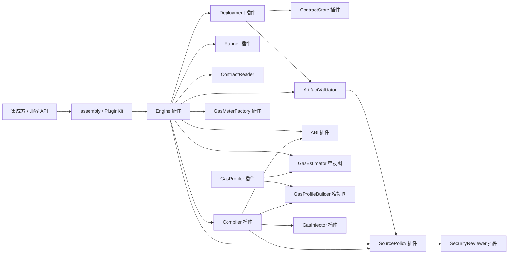

# 智能合约虚拟机模块化架构设计

## 1. 引言

### 1.1 编写目的
本文档描述 PluginKit 装配下的模块边界。各能力通过 core/cap 接口、Config/Deps 构造函数和显式配置图组合；注册与依赖排序复用 PluginKit，详见 [插件指南](plugins.md)。

### 1.2 设计目标
1. 打通 Compile → Deploy → Execute
2. 降低重复实现与双轨编译路径
3. 明确宿主侧与合约侧边界
4. 保持可测试、可演进

## 2. 整体架构



### 2.1 层次说明
1. **入口层**：`VMEngine`
2. **流水线层**：`ContractCompiler`（审查、ABI、Gas 注入、入口生成、构建）
3. **执行层**：`Runner`（进程超时执行）
4. **部署/存储层**：`ContractDeployer` 负责部署规则与地址，`ContractStore` 负责 Put/Get

## 3. 核心接口

### 3.1 Engine 业务门面

`core.Engine` 只组合业务能力：`Compile(ctx, source)`、`Deploy(ctx, artifact)`、`Get(ctx, address)`、`Execute(ctx, ExecutionRequest)`、`GenerateABI(ctx, source)` 和 `EstimateGas(ctx, address, function, opts)`。`Execute` 返回 `*ExecuteResult`，事件和 Gas 属于本次结果。

旧 getter、版本查询和 `Stop() error` 留在根包兼容门面。`assembly.Runtime.Stop(ctx)` 处理实例可选的 `Stop(context.Context) error`，生命周期不是 Engine 的必选职责。

### 3.2 编译与审查

```go
type ContractCompiler interface {
    Compile(context.Context, string) (*CompiledContract, error)
}
type SecurityReviewer interface { Review(string) error }
type SourcePolicy interface {
    Review(string) error
    ID() string
}
```

可选 `PolicyGuarantor.Guarantees()` 声明执行保证。确定性判断读取 `core.GuaranteesOf`，不把具体策略 ID 当作保证。产物接受规则由独立 `ArtifactValidator.ValidateArtifact(ctx, artifact)` 检查。

### 3.3 Runner

```go
type Runner interface {
    Run(context.Context, *CompiledContract, CallRequest) (*CallResult, error)
}
```

内建 `internal/process.ProcessRunner` 使用 `exec.CommandContext`，保留调用方取消与超时。

### 3.4 部署与存储

`ContractReader.Get(ctx, address)` 读取完整产物；`ContractWriter.Put(ctx, address, artifact)` 保存到调用方选择的地址，且不修改输入。`ContractStore` 组合两者，`ContractDeployer.Deploy(ctx, artifact)` 独立负责部署规则和地址分配。ABI、画像从读取结果投影，不再为每种字段增加存储接口。

### 3.5 Gas 与 ABI

`ABIGenerator.Generate`、`GasInjector.InjectGas` 各提供一个功能。`GasProfileBuilder.BuildProfile` 是编译器需要的画像能力；`GasEstimator.Estimate` 是引擎需要的模型解释能力。单个 `GasProfiler` 同时实现两者。内建模型只接受版本 1；旧根包 helper 对版本 0 的兼容适配不进入新契约。

`GasMeterFactory` 为每次调用创建独立计量器；`GasMetering` 的消耗、限额和查询共同表达一个计量器职责。

## 4. 明确后置的模块
- 完整 `ExecutionEnvironment` 沙箱（Docker/seccomp）
- Host Runtime / 默认库链状态后端
- 外部配置中心（PluginKit 配置装配已实现）
- 并行执行调度器
- 合约升级机制

## 5. 包结构原则
- core/cap 定义稳定契约，插件不依赖根包兼容入口
- plugins 提供注册工厂，internal 按 compiler/security/policy/gas/abigen/storage/deployment/process/engine 分包；compat 负责旧 API，builtin 仅保留历史回归测试
- assembly 负责唯一的 PluginKit 构建路径及生命周期
- contractapi 保持独立的合约侧依赖，避免引入宿主插件运行时

## 6. 与实现一致性
本文档描述的是当前重构后的目标边界。若实现调整，需同步更新：
- `architecture.md`
- `detailed_design/contract_processing_flow.md`
- `detailed_design/vm_engine_detailed_design.md`
- `execution_environment.md`
